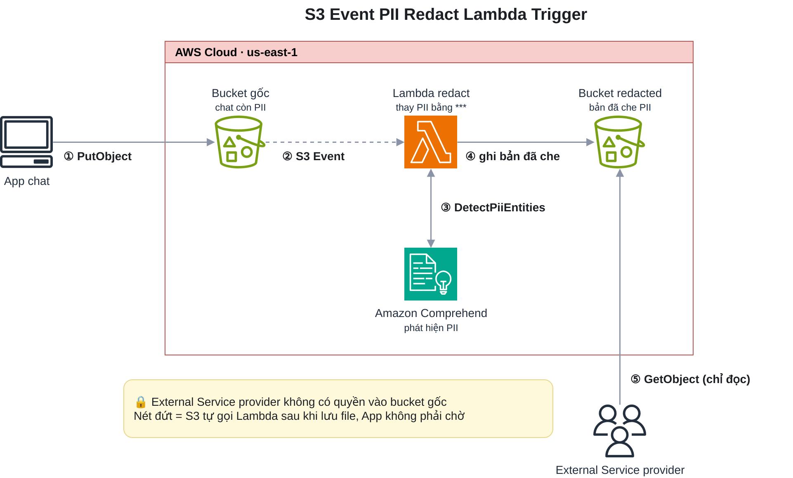

Che thông tin cá nhân (PII – Personally Identifiable Information) ngay khi ghi file: mỗi khi có file chat mới vào bucket gốc, S3 Event tự gọi Lambda. Lambda gửi nội dung sang Amazon Comprehend (DetectPiiEntities) để tìm PII, thay PII bằng dấu *, rồi lưu bản đã che sang bucket redacted. Người đọc chỉ được vào bucket redacted, không truy cập được bucket gốc.



## Luồng hoạt động

| Bước | Hành động | Ai thực hiện |
|------|-----------|--------------|
| ① | `PutObject` file chat (còn PII) vào bucket gốc | App chat |
| ② | S3 tự gọi Lambda sau khi lưu file, App không phải chờ (nét đứt) | S3 |
| ③ | Lambda gọi `DetectPiiEntities` để phát hiện entity PII | Lambda → Comprehend |
| ④ | Lambda ghi `chats/chat-001-redacted.txt` sang bucket redacted | Lambda |
| ⑤ | `GetObject` bản đã che, chỉ quyền đọc | External Service provider |

## Hướng dẫn chạy lab

### ⚠️ DÙNG ACCOUNT CÁ NHÂN ĐỂ TEST

- Chuẩn bị: AWS CLI v2, set IAM với quyền tối thiểu
- Có thể dùng Cloud Shell nếu muốn test nhanh.

```bash
chmod +x s3-pii-redact.sh
./s3-pii-redact.sh setup
```

Lệnh `setup` sẽ lần lượt:

1. Tạo 2 bucket `chat-raw-<account-id>` và `chat-redacted-<account-id>`, bật block public access.
2. Tạo IAM role `pii-redact-role` với quyền tối thiểu: đọc bucket gốc, ghi bucket redacted, gọi `comprehend:DetectPiiEntities`.
3. Đóng gói và tạo Lambda `pii-redact` (Python 3.13, 256 MB, timeout 30 giây) với biến môi trường `DEST_BUCKET`.
4. Gắn S3 Event Notification `ObjectCreated:*` trên bucket gốc để tự gọi Lambda.

Kiểm tra sau khi setup:

```bash
./s3-pii-redact.sh test     # upload chat-001.txt và đọc bản đã che
./s3-pii-redact.sh status   # xem tài nguyên đang có
```

Dọn dẹp khi xong Lab (script hỏi gõ `DELETE`, hoặc thêm `--yes` để bỏ qua xác nhận):

```bash
./s3-pii-redact.sh cleanup --dry-run   # xem trước, không xoá gì
./s3-pii-redact.sh cleanup -y
```
